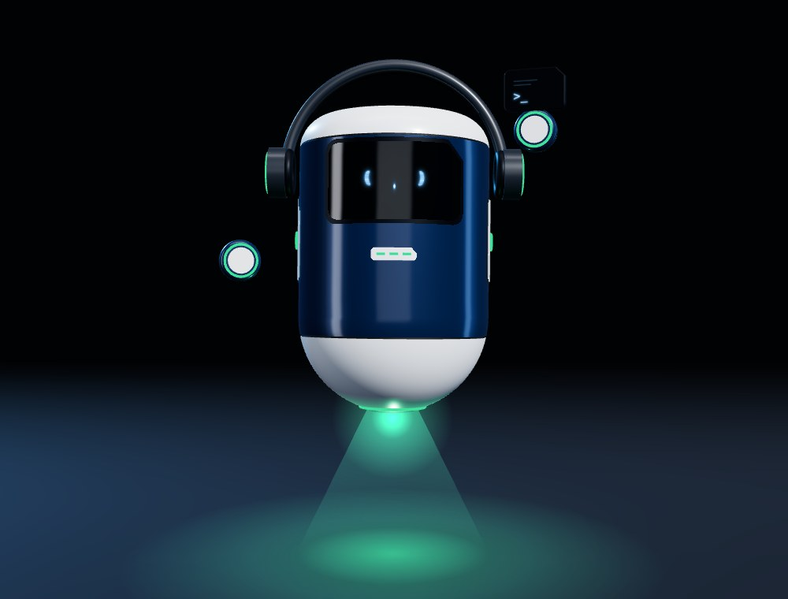
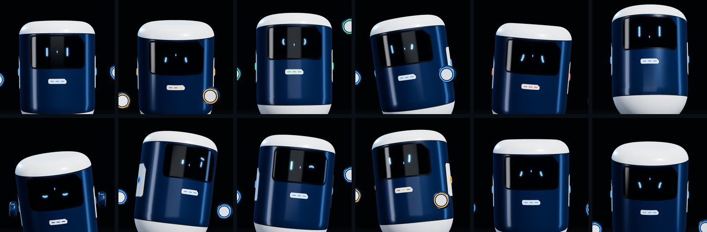
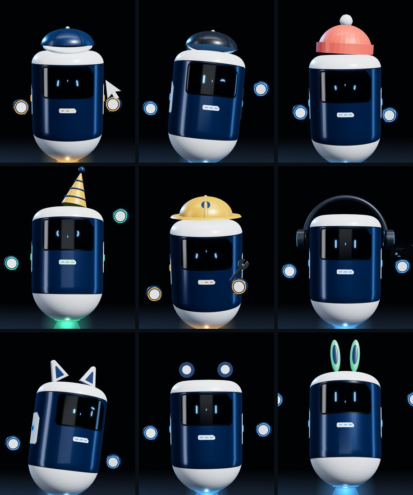
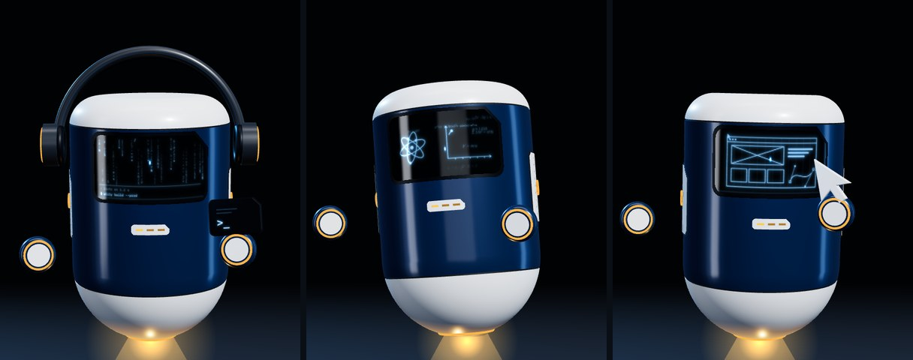

<div align="center">



# Utity Character

**La mascota 3D de [Utity](https://utity.io).** Una máquina flotante con herramientas intercambiables: segura, directa y algo seca. Resuelve sin ruido.

[Prototipo](mascota/index.html) · three.js · sin build

</div>

---

## Qué es

Un personaje que se define por **estados y comportamiento**, no solo por el dibujo. Sirve como protagonista animado de la landing y como voz de la marca en redes.

- **Cuerpo:** cápsula vertical en navy con tapa y placas cerámicas. Todo el lenguaje corporal sale de inclinaciones y giros.
- **Cara:** visor de cristal oscuro con dos ojos de luz parametrizados.
- **Módulos flotantes:** llevan la herramienta (cursor, llave o terminal). Así cuenta diseño y desarrollo a la vez.
- **Luz de levitación:** indica el estado.

## Expresiones



<sub>Atento · Concentrado · Éxito · Dudando · Error · Sorprendido · Dormido · **Seca** · Guiño · Pensando · Molesto · Triste</sub>

Hay 18 expresiones en total. Todas salen de una sola forma base de ojo y de reglas fijas:

| Parámetro | Rango | Uso |
| --- | --- | --- |
| Altura | 0 – 1 | Por debajo de 0.1 colapsa a guion (parpadeo y dormido) |
| Inclinación | ±20° | Positiva: foco y error. Negativa: duda y tristeza |
| Curvatura | −1 – 1 | Positiva arquea hacia arriba (éxito) |
| Chaflán | 0 – 1 | Siempre en la esquina exterior superior |
| Ceja | 0 – 1 | Solo en la expresión *seca* ("Ya, claro.") |

Fijos: grosor de trazo, brillo y rejilla de líneas. Hay 8 formas base intercambiables; la recomendada es la **01, píldora con chaflán**.

## Accesorios



<sub>Gorra · Gorra atrás · Gorro de lana · Gorro de fiesta · Casco de obra · Cascos de música · Orejas de gato · Orejas de oso · Orejas de conejo</sub>

Los accesorios flotan sobre la tapa y siguen al cuerpo con inercia. Las orejas también expresan: caen en error y tristeza, y se levantan con la sorpresa. Hay 6 acabados de marca.

## Modos de visor



<sub>**Código:** lluvia de glifos con terminal · **Ciencia:** ecuaciones, átomo y gráfica · **Boceto:** wireframe que se dibuja solo</sub>

## Movimientos

Ocho coreografías en bucle, sumadas a la expresión con fundidos para que nunca corte:

`giro` · `voltereta` · `animado` · `triste` · `frío` · `excitado` · `saludo` · `vuelo en ocho`

Cada movimiento anticipa, actúa y se asienta. Módulos y accesorios lo siguen con retraso, y el aplastamiento máximo es del 7 %: es una máquina, no goma.

## Estados

| Estado | Color | Cuándo |
| --- | --- | --- |
| Reposo |  `#4DB2FF` | Esperando |
| Trabajando |  `#FFB547` | Cargando, procesando |
| Éxito |  `#3DDC97` | Tarea completada |
| Error |  `#FF6B5E` | Algo falló |
| Dormido |  `#5B86B5` | 14 s sin actividad |

Navy de marca: `#1D4B7A`.

## Uso

Es un único HTML. Ábrelo en el navegador o sírvelo en local:

```bash
npx serve mascota
```

En la página:

- Sigue el cursor con el cuerpo y la mirada.
- Un clic lo sorprende; tres clics rápidos sacan la *seca*.
- Si lo dejas quieto, se duerme.
- Desde el panel lateral eliges forma de ojo, expresión, modo, movimiento, accesorio, acabado y herramienta.
- Tienes una demo automática y un botón de combinación aleatoria.

---

<div align="center"><sub>Utity · diseño y desarrollo</sub></div>
