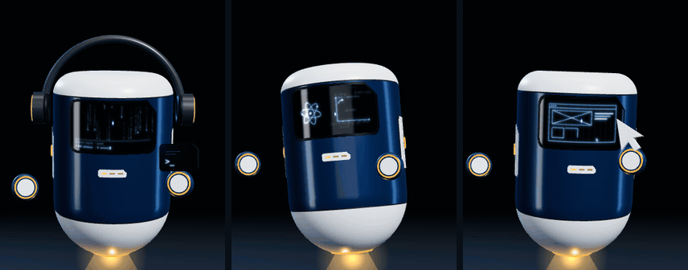

<div align="center">


# Utity Character

**The 3D mascot of [Utity](https://utity.io).** A floating machine with swappable tools: confident, direct, a little dry. Gets things done without the noise.

[Prototype](mascota/index.html) · three.js · no build step

</div>

---

## What it is

A character defined by **states and behaviour**, not just by its drawing. It works as the animated lead of the landing page and as the brand's voice on social media.

- **Body:** a vertical navy capsule with ceramic cap and side panels. All body language comes from tilts and turns.
- **Face:** a dark glass visor with two parametric light eyes and a small light mouth that moves when it talks.
- **Belly display:** a chamfered status screen in the state colour: a heartbeat when idle, segmented progress while working, a check on success, an alert on error, drifting z's when asleep.
- **Floating arms:** the side panels detach from the body and become arms. They are pills with the brand chamfer at the tip, a navy shell, a ceramic face and a light edge in the state colour. They gesture by rotating, carry the tool (cursor, wrench or terminal) at the tip, and dock back as panels.
- **Levitation light:** shows the current state.

## Expressions


<sub>Attentive · Focused · Success · Doubtful · Error · Surprised · Asleep · **Dry** · Wink · Thinking · Annoyed · Sad</sub>

There are 18 expressions in total. Every one comes from a single base eye shape and a fixed set of rules:

| Parameter | Range | Use |
| --- | --- | --- |
| Height | 0 – 1 | Below 0.1 it collapses to a dash (blink and sleep) |
| Tilt | ±20° | Positive: focus and error. Negative: doubt and sadness |
| Curvature | −1 – 1 | Positive arches upward (success) |
| Chamfer | 0 – 1 | Always on the outer top corner |
| Brow | 0 – 1 | Only in the *dry* expression ("Yeah, sure.") |

The mouth follows the same logic with its own parameters (width, curve, openness, offset, tilt and wave). Its stroke is thinner than the eyes so it never competes with them, and it opens briefly every time the line of copy changes.

Fixed: stroke weight, glow and scanline grid. There are 8 interchangeable base shapes; the recommended one is **01, chamfered pill**.

## Accessories


<sub>Cap · Backwards cap · Beanie · Party hat · Hard hat · Headphones · Cat ears · Bear ears · Bunny ears</sub>

Accessories float above the cap and follow the body with inertia. Ears are expressive too: they droop on error and sadness and perk up on surprise. Six brand finishes are available.

## Visor modes



<sub>**Code:** glyph rain with a typing terminal · **Science:** equations, an atom and a plotting graph · **Sketch:** a wireframe that draws itself</sub>

In these modes the eyes collapse and a top-to-bottom sweep paints the visor, using the same light, glow and grid as the eyes.

## Motions

Eight looping choreographies, layered on top of the expression with crossfades so nothing ever cuts:

`spin` · `flip` · `dance` · `sad` · `cold` · `excited` · `wave` · `figure-eight flight`

Every motion anticipates, acts and settles. Arms and accessories follow with a delay, and squash is capped at 7 %: it's a machine, not rubber.

## States

| State | Colour | When |
| --- | --- | --- |
| Idle |  `#4DB2FF` | Waiting |
| Working |  `#FFB547` | Loading, processing |
| Success |  `#3DDC97` | Task done |
| Error |  `#FF6B5E` | Something failed |
| Asleep |  `#5B86B5` | 14 s without activity |

Brand navy: `#1D4B7A`.

## Usage

It's a single HTML file. Open it in a browser or serve it locally:

```bash
npx serve mascota
```

On the page:

- It follows the cursor with its body and gaze.
- One click surprises it; three quick clicks trigger the *dry* look.
- Leave it alone and it falls asleep.
- The side panel picks eye shape, expression, visor mode, motion, accessory, finish and tool.
- There's an auto demo and a random combination button.

> The prototype UI is in Spanish; this README is the English reference.

---

<div align="center"><sub>Utity · design & development</sub></div>
